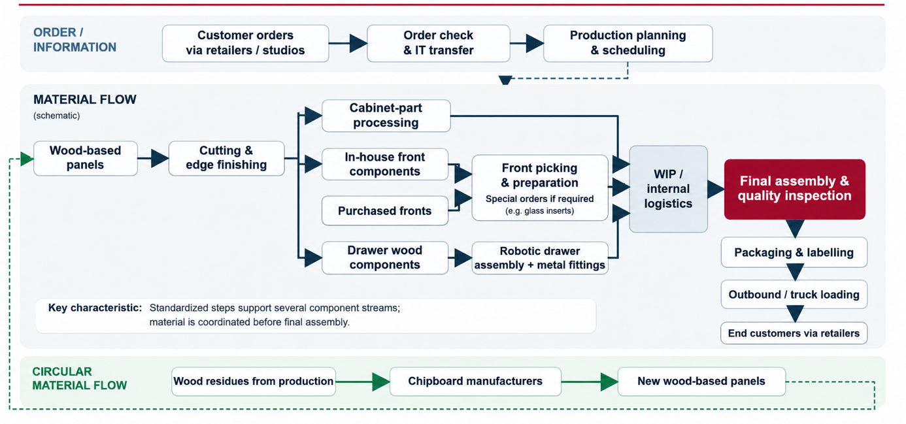
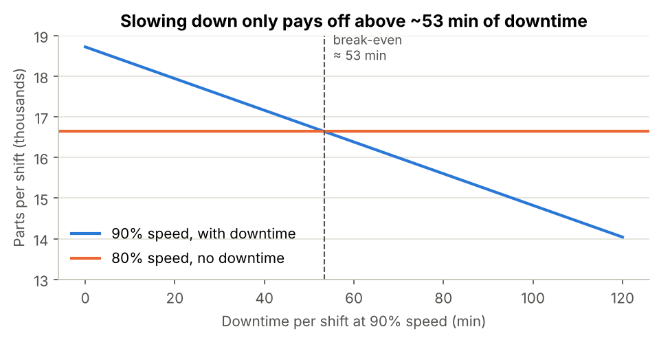
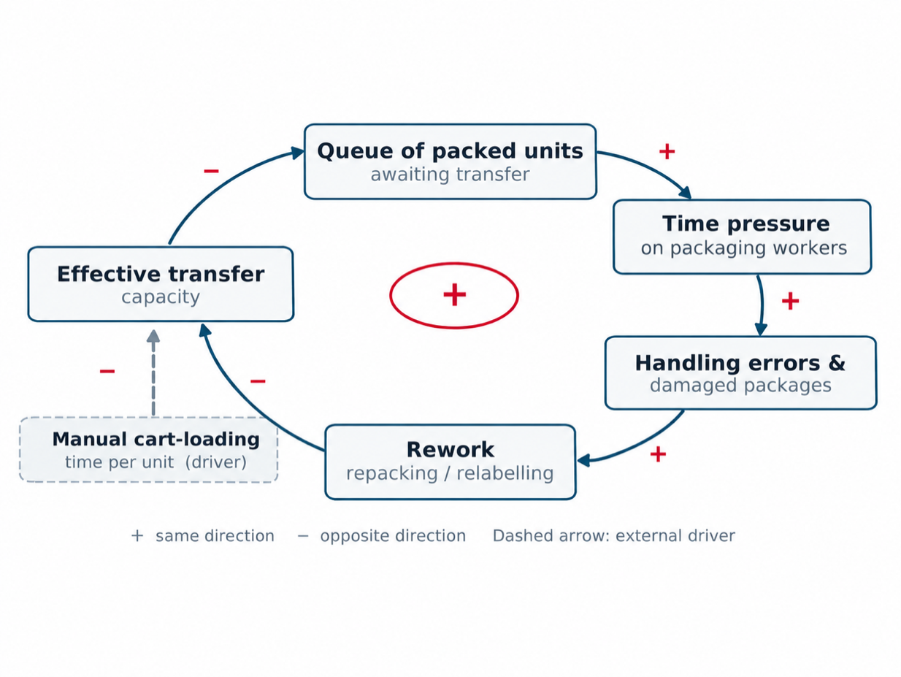

# Operational Excellence at Nobilia: Production System Analysis

Consulting-style analysis of the production system of **Nobilia**, a large German kitchen manufacturer, based on a **virtual-reality factory tour**. This was a group project in the M.Sc. Supply Chain Management at the University of Cologne (November 2026).

The team mapped the value chain, assessed product modularity, timed production activities in the tour, identified waste (Lean / *muda*), and designed incremental, radical and sustainability improvements. For this repository I also **rebuilt the improvement scenarios in Python** to make every number reproducible and to test how sensitive they are to the assumptions.

📄 [Read the full report](executive_report.md) · 📓 [Open the scenario notebook](improvement_scenarios.ipynb)

---

## Business question

How can a mass-customization manufacturer, with highly automated standard steps and manual, variant-rich steps, improve flow, productivity and sustainability without losing flexibility?

## What the analysis covers

| Area | Methods & concepts |
|---|---|
| **Value chain & process architecture** | Information, material and circular flows; 9-process matrix (input → transformation → output) |
| **Customer order decoupling point** | Push vs pull, assemble-to-order, mass customization |
| **Product architecture** | Modular vs integral assessment of a kitchen cabinet |
| **Performance measurement** | KPI framework (2 KPIs per process); time studies from the VR tour |
| **Lean** | Seven wastes (*muda*); causal-loop diagram of a congestion spiral |
| **Improvements** | Pick-by-Light, line-speed optimization, automated packaging, autonomous mobile robots (AMRs) |
| **Sustainability** | Environmental and social assessment; take-back of end-of-life kitchens; ergonomic workstations |

<p align="center">
  <br>
  <em>End-to-end value chain: information, material and circular flows</em>
</p>

## Key findings

- **Push/pull split:** upstream steps (cutting, edge finishing, storage) are forecast-driven and highly automated. From front picking onwards, with at least 17,600 colour/size combinations, the flow becomes order-driven, lot-size-one and mostly manual.
- **The product is predominantly modular:** carcass, fronts, drawers and fittings connect through defined interfaces, which makes variety possible without redesigning the cabinet.
- **Disruptions matter more than speed:** one machine stop cut edge-finishing output by about 44% in a one-minute window (22 vs 39 parts/min).
- **Radical changes beat incremental ones:**

| Scenario | Type | Current → scenario | Change |
|---|---|---|---|
| Pick-by-Light (2 s saved per item) | Incremental | 192 → 232 orders/shift | +20.8% |
| Edge finishing at 80% speed, no downtime | Incremental | 16,380 → 16,640 parts/shift | +1.6% |
| Automated packaging & cart transfer | Radical | 1,309 → 1,920 units/shift (capacity) | +46.7% |
| AMRs for internal transport | Radical | 10 → 2 worker hours/shift | −80% |

<p align="center">
  
  
</p>

**Break-even insight:** slowing the edge-finishing line from 90% to 80% speed only pays off if it removes more than **~53 minutes of downtime per shift**. The real priority is therefore to *measure downtime over full shifts* before changing the line settings.

## Repository structure

```
nobilia-production-system-analysis/
├── README.md
├── executive_report.md           # full report (public version)
├── improvement_scenarios.ipynb   # measurements, scenario models, sensitivity analysis
├── *.csv                         # data: observations, measurements, KPIs, assumptions
├── *.png                         # own diagrams + charts from the notebook
└── requirements.txt
```

## How to run

```bash
pip install -r requirements.txt
jupyter notebook improvement_scenarios.ipynb
```

## Limitations

- Measurements are short snapshots from a VR tour (minutes, not full shifts).
- Improvement effects are **illustrative scenarios** based on stated assumptions, not observed gains.
- Quality, material yield and delivery reliability would need real operational data.

## My role

Group project (team of four). I contributed to the report sections, including the **product architecture (modularity) assessment**, and built this repository: the datasets, the Python scenario models and the sensitivity analysis.

## Skills demonstrated

Process mapping · value chain analysis · push/pull & decoupling point · modularity · KPI design · time studies · Lean (*muda*) · system dynamics (causal loops) · scenario & break-even analysis · Python (pandas, matplotlib) · sustainability assessment

---

*Based on a university assignment. Company information comes from the VR factory tour and Nobilia's public reports. Team members' names and tour photos are not included.*
