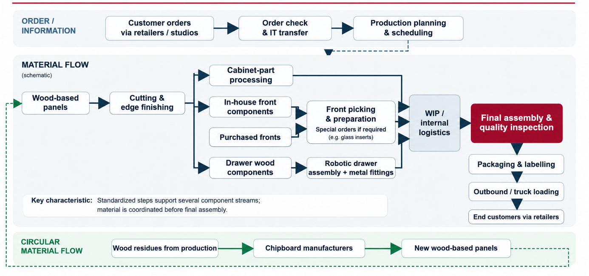
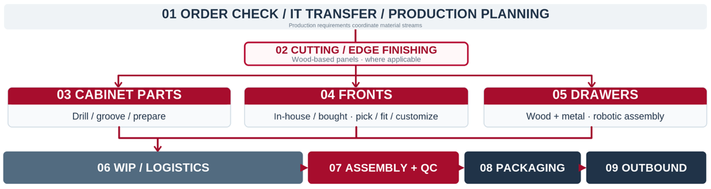
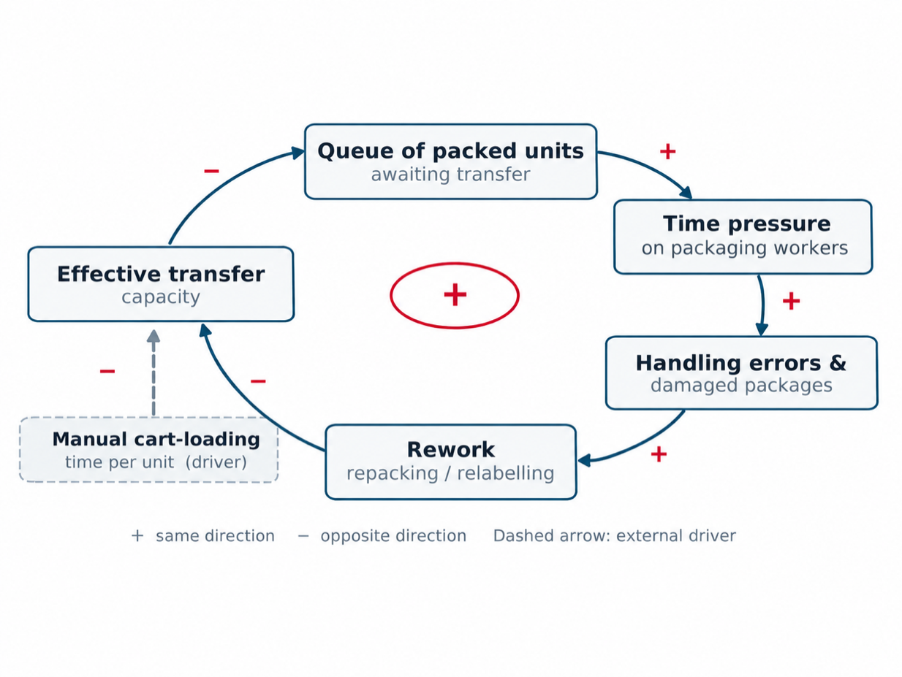
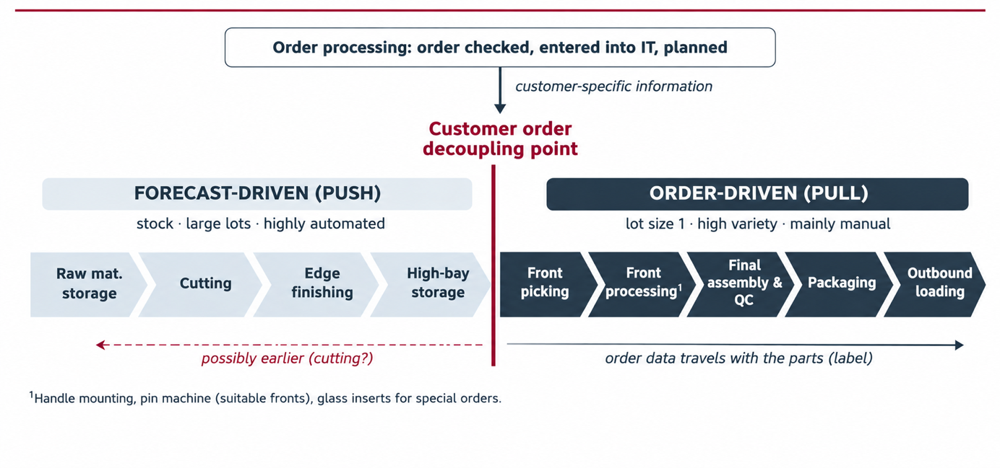

# Operational Excellence at Nobilia
### Production System Analysis & Improvement Opportunities

*Executive management report · Group consulting project (team of four) · M.Sc. Supply Chain Management, University of Cologne · November 2026*

> Public version: team members' names and the photos taken from the VR factory tour have been removed. Diagrams are the team's own illustrations.

---

## Nobilia’s Value Chain

Nobilia’s value chain combines standardized, highly automated manufacturing with customer-specific order processing to enable mass customization. Customer orders from retailers and kitchen studios are checked and transferred into the central IT system, where production planning and scheduling take place. In parallel, suppliers provide wood-based panels, fronts, fittings and other components.

As illustrated in Figure 1, the production system consists of several interconnected material flows. Wood-based panels undergo cutting, edge finishing and further processing, supplying components for cabinet and drawer manufacturing. In-house processed and purchased fronts enter a separate storage, picking and preparation stream, while drawers are assembled robotically from wooden and metal components[^1]. Work-in-progress (WIP) storage and internal logistics coordinate these material flows before they converge at final assembly. Following quality inspection, assembled cabinets and individual components are packaged, labelled and dispatched through the retail network to end customers.

Nobilia combines automation in standardized, high-volume operations with manual flexibility in processes characterized by extensive product variety and smaller quantities, particularly front picking. Additionally, wood residues are returned to chipboard manufacturers, establishing a circular material flow alongside the main value chain.

Figure 1: Nobilia’s End-to-End Value Chain – Information, Material and Circular Flows

Source: Own illustration based on the tour (created with the support of ChatGPT)

## Key Processes & Production Architecture

### Process Architecture

Nine processes \| parallel components \| synchronized final assembly

Figure 2: Production Process Architecture \| Sequential and Parallel Process Flows

Source: Own illustration based on the tour (created with the support of ChatGPT)

Table 1: Process Matrix

| **KEY PROCESS**              | **INPUT**                 | **TRANSFORM**             | **OUTPUT**              | **OBSERVATION**                           |
|------------------------------|---------------------------|---------------------------|-------------------------|-------------------------------------------|
| **Order processing**         | Customer orders           | Check, transfer, schedule | Production requirements | Office workstations                       |
| **Cutting / edge finishing** | Wood-based panels         | Saw, band & trim edges    | Prepared panels         | Large batches; highly automated           |
| **Cabinet processing**       | Prepared panels           | Drill & groove            | Cabinet parts           | Machined side panels staged               |
| **Front preparation**        | In-house & bought fronts  | Pick, fit & customize     | Prepared fronts         | Manual picking; glass inserts             |
| **Drawer assembly**          | Wood + metal parts        | Robotic joining           | Assembled drawers       | Robot-assisted wood-metal assembly        |
| **WIP & logistics**          | Work-in-process parts     | Buffer, move, stage       | Parts ready at line     | Stores & roller conveyors                 |
| **Assembly & QC**            | Cabinet parts; fronts     | Assemble & inspect        | Inspected cabinets      | Manual inspection; visible approval stamp |
| **Packaging**                | Cabinets / parts; cartons | Wrap, strap & label       | Shipping units          | Manual wrap; auto straps                  |
| **Outbound**                 | Packaged units            | Stage, load & secure      | Loaded trucks           | Manual loading of mixed-sized units       |

*Tour photos (edge finishing overview, manual WIP warehouse, assembly) omitted in this public version.*

### Management Implication

Automate stable, high-volume steps \| Keep flexibility for diverse fronts \| Synchronize component availability at assembly

## Causal Loop: Potential Congestion Spiral

A potential reinforcing feedback loop at the manual cart-loading interface

**Observed transfer:** At the packaging–outbound interface, packed cabinets are manually transferred from the line onto towline carts. The tour shows a worker at this transfer point and units awaiting handling. Empty carts are also visible. *(Figure 3, a tour photo of the transfer point, omitted in this public version.)*

Reinforcing \| Potential congestion spiral

Figure 4: Reinforcing causal loop \| two negative causal links make the overall feedback reinforcing

Source: Own illustration based on the tour (created with the support of ChatGPT)

**Causal mechanism:** When incoming packed units exceed effective transfer capacity, a queue grows. This may raise time pressure, handling errors and rework. Repacking or relabeling occupies transfer labor, reduces effective capacity and increases the queue further.

**Management implication:** The risk is a self-reinforcing loss of transfer performance. Test the hypothesis by tracking queue length, unit transfer times, rework frequency and available operators. Additional carts alone would not prevent congestion at peak times.

## Customer-Specific Information

Customer-specific information enters Nobilia’s value chain in order processing. Retailer orders are checked for errors and transferred into the IT system, which triggers planning, scheduling, production and shipping. Each order represents a unique combination of standardized modules.

The upstream stages operate independently of individual orders (Figure 5). Chipboard is held in stock, edge finishing runs in large lots due to low variety, and the automated high-bay warehouse stores front material. Customer-specific requirements become physically relevant at the latest during front picking, where fronts are selected from at least 17,600 color and size combinations. This process is performed manually because quantities per variant are too small to justify automation. Subsequent steps, including handle mounting, special orders, assembly, packaging and truck loading, follow the individual order. Manufacturing labels carry order information through production and are removed after assembly.

This customer order decoupling point has three effects. First, production control shifts from push to pull, moving from stock production in large lots towards lot size one. Second, automation decreases as product variety increases, making manual operations more prominent downstream. Third, order information must accompany each component, while carcass, front and drawer flows must be synchronized to arrive at assembly at the right time. Nobilia therefore follows an assemble-to-order approach to mass customization. However, the available process observations do not establish whether cutting is already order-specific, meaning the decoupling point may lie further upstream.

Figure 5: Nobilia’s Production Flow \| Forecast-Driven (Push) and Order-Driven (Pull) Processes Around the Customer Order Decoupling Point (CODP)

Source: Own illustration based on the tour (created with the support of ChatGPT)

## Modular Product Architecture

A product has a modular architecture when its components perform distinct functions and can be changed independently through clearly defined interfaces. In an integral architecture, components are strongly interdependent, so changing one often requires changes to others. The kitchen cabinet is selected as a visible example of Nobilia's product architecture. It is predominantly modular, as distinct components fulfill different functions and are connected through defined mechanical interfaces. The carcass provides structural support, while fronts, drawers and fittings enable different configurations.

**Table 2: Modularity Assessment of Kitchen Cabinet Components**

| **COMPONENTS**       | **FUNCTION**                                            | **MODULARITY ASSESSMENT**                                 |
|----------------------|---------------------------------------------------------|-----------------------------------------------------------|
| **Carcass**          | Structural support; pre-drilled and grooved panels      | Standardized base structure                               |
| **Fronts**           | Appearance and access; separate picking and preparation | Configurable within compatible dimensions                 |
| **Drawers**          | Storage function; separately assembled by robots        | Optional subassembly with defined interfaces              |
| **Handles & hinges** | Access and attachment; variant-specific fitting         | Interchangeable within compatible mounting specifications |

**Assessment:** Separate component manufacturing and defined attachment points support modularity and enable product variety without redesigning the entire cabinet. However, dimensions, hinge positions and structural requirements limit interchangeability. The carcass also exhibits strong internal dependencies between its panels.

## KPIs & Sample Measurements

To assess Nobilia's operational performance, two complementary KPIs are proposed for each key process. Selected production activities were additionally measured using observations from the factory tour.

**Table 3: Key Performance Indicators Across Nobilia’s Production Processes**

| **KEY PROCESSES**                     | **PRIMARY KPI**                          | **SECONDARY KPI**           |
|---------------------------------------|------------------------------------------|-----------------------------|
| **Order Processing & Planning**       | Order Processing Lead Time (h/order)     | First-Time-Right Rate (%)   |
| **Cutting & Edge Finishing**          | Material Yield (%)                       | Output Throughput (parts/h) |
| **Cabinet Component Processing**      | Processing Time (s/part)                 | First-Pass Yield (%)        |
| **Front Preparation & Customization** | Picking Accuracy (%)                     | Picking Time (s/pick)       |
| **Robotic Drawer Assembly**           | Output Throughput (drawer/h)             | First-Pass Yield (%)        |
| **WIP Logistics & Storage**           | Kit Availability (%)                     | WIP Dwell Time (h)          |
| **Final Assembly & Quality Control**  | Assembly Output (cabinets/h)             | First-Pass Yield (%)        |
| **Packaging & Labelling**             | Packaging Cycle Time (s/unit)            | Packaging Accuracy (%)      |
| **Outbound Logistics**                | Loading Productivity (units/person-hour) | On-Time Dispatch Rate (%)   |

### Sample Measurements

Selected production activities were observed in the factory tour. Repeated observations were used where the footage permitted comparable, independently observable events.

**Table 4: Sample Measurements of Selected Production Processes**

| **PROCESS / OBSERVATION**   | **SAMPLE SIZE** | **MEAN**               | **KPI**                       |
|-----------------------------|-----------------|------------------------|-------------------------------|
| **Edge Finishing**          | n = 5x1min      | 35.6 parts/min         | Output Throughput (parts/h)   |
| **Robotic Drawer Assembly** | n = 5x1min      | 4.4 drawer/min/station | Output Throughput (drawer/h)  |
| **Final Assembly**          | n = 5x1min      | 2.8 cabinets/min       | Assembly Output (cabinets/h)  |
| **Manual Packaging**        | 5 operations    | 17.4 s/operation       | Packaging Cycle Time (s/unit) |

### Limitations

Observed disruptions affected edge finishing, drawer assembly and final assembly. Excluding the disruption-affected first edge-finishing observation yields 39 parts/min across the remaining four windows. Assembly output counts are also influenced by cabinet size and conveyor occupancy despite constant belt speed. As only short sections of the production processes were available, longer observation periods and continuous measurements were not possible. Therefore, the results represent limited snapshots rather than full-shift capacity or standardized cycle times. Quality, material yield and delivery reliability require additional operational data.

## Waste (Muda) Assessment

Nobilia's key processes were assessed against the seven types of waste[^2]. The observations and our measurements reveal specific operational interruptions, while other potential inefficiencies require further validation.

**Table 5: Seven Types of Waste (Muda) – Process Observations and Assessment**

| **MUDA TYPE** | **RELEVANT PROCESSES** | **POTENTIAL WASTE** | **ASSESSMENT** |
|---|---|---|---|
| **Waiting** | Edge Finishing, Drawer Assembly, Cart-loading | machine disruptions; worker waited for packaged cabinets | Observed |
| **Motion** | Front Preparation, Packaging, Outbound | Manual picking and package handling; repeated reaching and bending during processing | Observed |
| **Transportation** | WIP Logistics, Packaging, Outbound | Components move through several transfer points. Packaged units are manually transferred from conveyors onto transport carts. Hand-cart routes are poorly marked or not followed. Workers cross them, parked carts block aisles, and workers stop to agree where carts go | Potential unnecessary handling |
| **Inventory** | Front Preparation, WIP Logistics | Large intermediate buffers and separate front inventories | Excess not confirmed |
| **Overproduction** | Fronts | Potential excess inventory due to outdated designs that are difficult to sell or no longer sell at all | Not confirmed |
| **Defects** | Front Preparation, Final Assembly, Packaging | High variant complexity and manual handling create potential picking and damage risks; actual defect rates are unavailable | Not confirmed |
| **Overprocessing** | Packaging | Every unit is wrapped and strapped; protection may exceed transport needs | Not confirmed |

### Management Implication

The clearest improvement opportunities concern production interruptions and manual material handling. Short-term disruptions were directly observed, while transfer congestion may further affect downstream flow. Transport, overproduction and inventory should be investigated before classifying them as avoidable waste. Priorities are to quantify downtime, transfer waiting times and defect rates.

## Sustainability Impact

Nobilia combines material recovery and energy-efficient technologies with resource-intensive manufacturing and manual handling activities.

**Table 6: Environmental and Social Assessment of Nobilia's Processes**

| **PROCESS / AREA**              | **ENVIRONMENTAL IMPACT**                                                                                                                                    | **SOCIAL IMPACT**                                                                                                 |
|---------------------------------|-------------------------------------------------------------------------------------------------------------------------------------------------------------|-------------------------------------------------------------------------------------------------------------------|
| **Order Processing**            | \-                                                                                                                                                          | (+) potential remote working                                                                                      |
| **Cutting & Edge Finishing**    | (+) Approx. 90,000 tonnes of wood residues annually; most are returned to chipboard production                                                              | (-) Extensive automation reduces direct manual processing                                                         |
| **Cabinet & Drawer Processing** | (-) Automated machinery requires energy                                                                                                                     | (+) Robotic drawer assembly reduces repetitive manual joining                                                     |
| **Storage & WIP Logistics**     | (+) High-bay storage recovers energy during downward movements (recuperation); (-) internal transport still consumes resources                              | (+) Automation reduces some handling tasks, while manual component provision remains                              |
| **Front Preparation**           | \-                                                                                                                                                          | (-) Manual picking, handle mounting and special orders involve repetitive handling and potential ergonomic strain |
| **Final Assembly**              | \-                                                                                                                                                          | (-) Manual assembly and inspection involve repeated physical activities                                           |
| **Packaging**                   | (+) Reusable trays and foldable cardboard containers (~ 98% packaging materials are recyclable)[^3]                                                         | (-) Manual packing and cart loading create potential ergonomic demands                                            |
| **Outbound Logistics**          | (-) Around 100 trucks are loaded daily, creating transport-related environmental impacts; (+) trailers are stacked to use space optimally                   | (-) Fully manual trailer loading involves handling packages of different sizes                                    |
| **Energy & Circularity**        | (+) Compressor waste heat heats halls in spring/autumn; ~2–3 % of wood residues heat 100,000 m² in winter; (+) take-back program of old kitchens in Belgium | \-                                                                                                                |

### Overall Assessment

Nobilia's strongest documented environmental measures are wood recycling, waste-heat recovery and energy recuperation. However, packaging, industrial energy demand and truck transport remain environmental burdens.

Socially, automation reduces some manual tasks, while front picking, packaging and loading present potential ergonomic risks. Without data on emissions, workplace injuries, wages or working hours, a comprehensive sustainability assessment is not possible.

## Incremental Improvements

Two targeted pilots retain Nobilia’s process architecture. All improvements below are illustrative scenarios, not observed gains.

### 01 Visual guidance for manual front picking (Pick-by-Light)

**Evidence \| Action** One observed collection of 13 fronts took approximately 150 s, including walking and handling. Pilot shelf-level light cues linked to the existing order display in the picking zone.

**Table 7: Pick-by-Light Implementation**

| **13-ITEM ORDER / ONE OPERATOR** | **OBSERVED BASELINE** | **1s SAVED PER ITEM** | **2s SAVED PER ITEM** |
|----------------------------------|-----------------------|-----------------------|-----------------------|
| **Time per order**               | 150 s                 | 137 s                 | 124 s                 |
| **Orders per 8-h shift**         | 192                   | ≈210 (+18)            | ≈232 (+40)            |

**Improvement:**

In our scenario, implementing a Pick-by-Light system could improve orientation and reduce search times, allowing up to 40 additional orders to be picked per 8-hour shift.

### 02 Optimize edge-finishing speed for effective output

**Evidence \| Action** Five one-minute observations recorded outputs of 22, 40, 36, 39 and 41 parts, with an average of 39 parts/min across the four less-disrupted periods. Additionally, a machine stoppage of approximately 72 seconds was observed. We assume that the line runs at 90% speed, that output changes proportionally with speed and, since one stop in six minutes is likely above average, 60 min of downtime per 8-hour shift. We then test whether 80% speed without stoppages delivers more.

**Table 8: Edge-Finishing Speed Optimization**

| **ILLUSTRATIVE SCENARIO** | **90% SPEED**              | **80% SPEED**                 |
|---------------------------|----------------------------|-------------------------------|
| **6-minute period**       | 72 s stop → ≈187 parts     | No stop → ≈208 parts (+11.1%) |
| **8-hour shift**          | 60 min stop → 16,380 parts | No stop → 16,640 parts (+260) |

**Decision threshold** For the six-minute comparison, 80% speed wins only if stoppage exceeds 40 s. Across a full 8-hour shift, with zero downtime at 80%, the 90% setting must lose over 53 min to downtime before slowing down pays off.

**Improvement:**

In our scenario, reducing the operating speed from 90% to 80% could increase effective output by up to 1.59% per shift, provided that machine downtime is sufficiently reduced.

## Radical Improvements

Two radical changes to observed manual handling. All results are illustrative, not observed gains.

### 01 Flexible Automated Packaging & Cart Transfer

**Evidence \| Redesign** The tour shows manual carton application and cart loading. Automate both for compatible cabinets, link existing strapping and retain an exception route. Empty carts rule out a cart shortage, not a manual-transfer constraint.

**Table 9:** **Automated Packaging and Cart Transfer \| Efficiency Improvements**

| **SCENARIO METRIC**                     | **CURRENT PROCESS**                       | **REDESIGNED PROCESS**        |
|-----------------------------------------|-------------------------------------------|-------------------------------|
| **Manual touch time1**       | 22.0 s/unit (17.4 measured + 4.6 assumed) | 15.0 s/unit (assumed; -31.8%) |
| **Ideal units / 8-h shift2** | 1,309                                     | 1,920 (+611; +46.7%)          |

**Improvement:**

In our scenario, integrating packaging and cart loading into one automated process could reduce total processing time from 22 to 15 seconds per unit (−31.8%). Under a simplified sequential-process assumption, this could increase theoretical capacity by up to 611 additional units per 8-hour shift (+46.7%).

### 02 Autonomous Mobile Robots for Internal Transport

**Evidence \| Redesign** Carts with fronts and WIP parts are pushed by hand; parked carts block aisles (WIP Storage 4). Introduce AMRs on fixed routes with docking zones, linked to order data. They move carts, not products, so variety does not limit them. Retain an exception route.

**Table 10:** **Autonomous Mobile Robots for Internal Transport \| Illustrative Labour and Flow Effects**

| **ILLUSTRATIVE SHIFT SCENARIO**            | **CURRENT ASSUMPTION** | **REDESIGNED ASSUMPTION** |
|--------------------------------------------|------------------------|---------------------------|
| **Worker time / 8-h shift3**    | 120 × 5 min = 10 h     | 120 × 1 min = 2 h (−80%)  |
| **Blocked aisles / 8-h shift3** | 20 × 2 min = 40 min    | ≈5 min (−88%)             |

**Improvement:**

In our scenario, AMRs could release about 8 working hours per shift. The 5 min per trip is working time for pushing the cart and walking back; with AMRs, the worker only hooks up the cart (1 min) while the robot travels alone. A pilot on one route should come first.

*¹ Carton application measured, n=5. Cart lifting (4.6 s) and automated cycle duration (15 s) are assumptions. ² Modelled 8-h station capacities exclude breaks, downtime, strapping and other line constraints. 3 ≈1,344 cabinets/shift (2.8 cabinets/min measured at final assembly × 480 min) ÷ ~11 per cart ≈ 120 trips; cart load, times, blockages assumed.*

## Sustainability Improvements

(Based on the tour and Nobilia’s sustainability journal 2026[^4])

### 01 Environmental Sustainability \| Regional Take-Back of End-of-Life Kitchens

| **Evidence**        | Nobilia already recycles production wood residues and operates a kitchen take-back pilot in Belgium. End-of-life chipboard is still often incinerated rather than materially recycled |
|---------------------|---------------------------------------------------------------------------------------------------------------------------------------------------------------------------------------|
| **Proposed change** | Extend the Belgian concept to selected German retailers. Trained fitters dismantle old kitchens and separate recyclable wood for collection                                           |
| **Implementation**  | Use the existing Assembly Academy for training and assess retailer collection points, possible return transport and established disposal partners                                     |
| **Expected impact** | More recycled wood, reduced incineration and a stronger circular material supply                                                                                                      |

**KEY TAKEAWAY \|** Start with a regional pilot to validate collection costs, retailer participation and recycling benefits before expanding

### 02 · Social Sustainability \| Ergonomic Redesign of Manual Workstations

| **Evidence**        | Manual front picking, handle mounting and packaging involve physical handling. Low component storage and floor-level packages create potential ergonomic strain |
|---------------------|-----------------------------------------------------------------------------------------------------------------------------------------------------------------|
| **Proposed change** | Introduce height-adjustable workbenches, level-keeping lifting platforms and elevated material presentation where suitable                                      |
| **Implementation**  | Test the equipment at selected manual workstations, adapting working heights to employees and tasks                                                             |
| **Expected impact** | Less repeated bending, fewer awkward postures and lower physical handling demands                                                                               |

**KEY TAKEAWAY \|** Pilot ergonomic adjustments at one workstation and evaluate their effects before wider implementation

[^1]: Nobilia-Werke J. Stickling GmbH & Co. KG. (2023). Geschäftsbericht 2022

[^2]: Ohno, T. (1988, pp. 41-44). Toyota production system: Beyond large-scale production. Productivity Press

[^3]: nobilia. (2026). Nachhaltigkeitsjournal 2026

[^4]: nobilia. (2026). Nachhaltigkeitsjournal 2026
